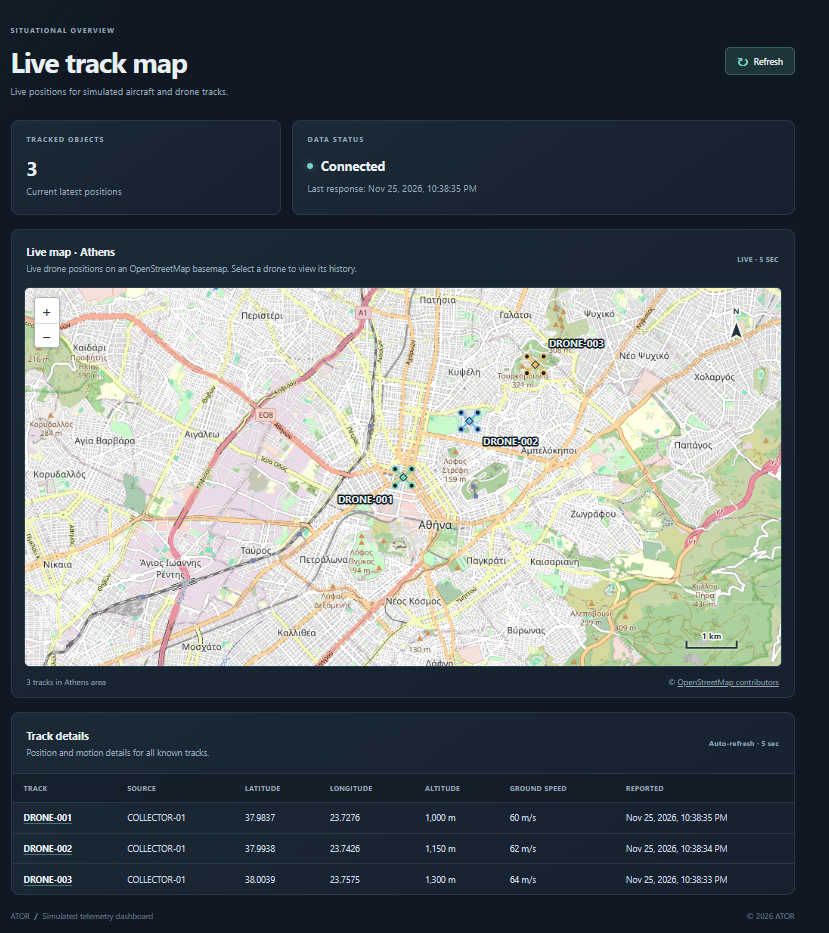
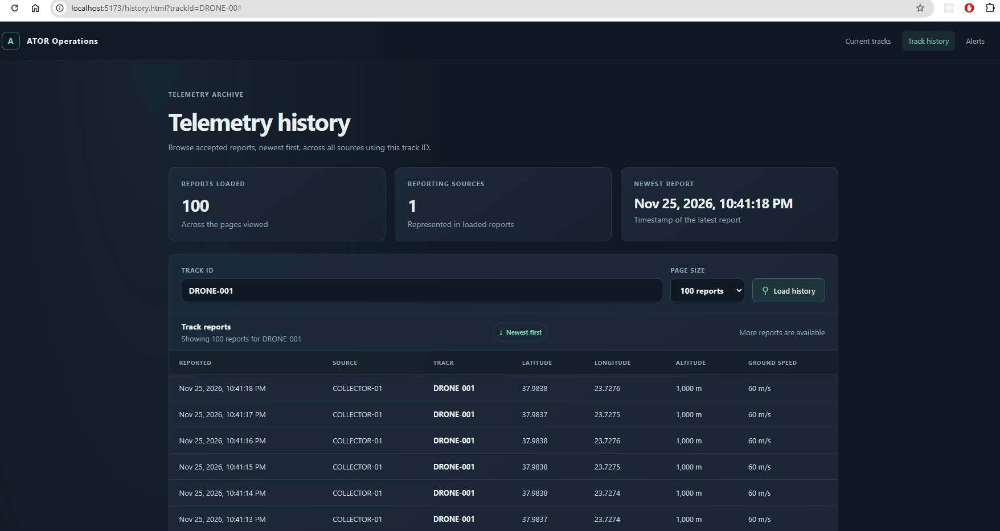
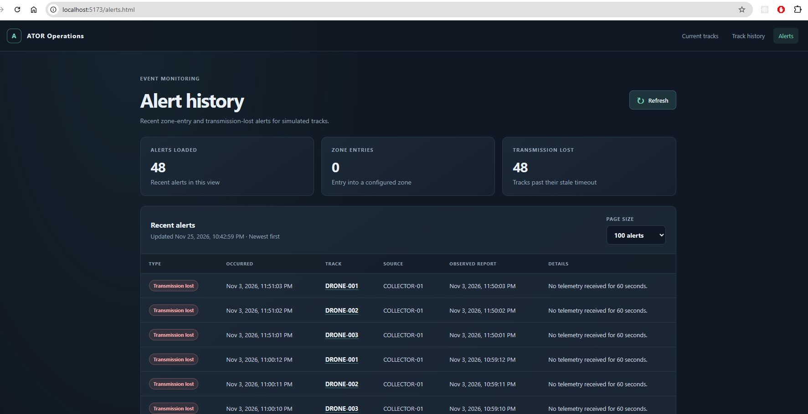

# Dashboard

The Dashboard is a standalone, framework-free JavaScript frontend. Nginx serves
the static files and proxies API requests to the Consumer over the private
Docker Compose network. The browser therefore uses same-origin `/api` URLs and
does not need CORS configuration.

## Structure

```text
ATOR/
  Dashboard/
    Dockerfile
    nginx.conf
    images/
      AlertHistory.png
      LiveTrackMap.png
      TelemetryHistory.png
    public/
      index.html
      assets/
    package.json
    playwright.config.cjs
    tests/
```

- `app.js` wires page events, polling, and loading/error states.
- `features` pages use the shared `ator-site-header` component for consistent
  navigation and active-page indication.
- `features/tracks/current-tracks-api.js` owns HTTP access and response checks.
- `features/tracks/current-tracks-view.js` renders track data using DOM APIs;
  `live-map-view.js` plots current positions over OpenStreetMap tiles centered
  on Athens. The map loads only the tiles needed for the current view from the
  OpenStreetMap tile service; internet access is required. Map attribution is
  displayed below the map, and zoom controls load tiles on demand. The browser
  handles tile caching; the dashboard does not prefetch or store tiles offline.
  The public tile service is community-funded and best-effort; deployments with
  significant traffic should use a dedicated map-tile provider and follow its
  usage terms. See the [OpenStreetMap tile usage policy](https://operations.osmfoundation.org/policies/tiles/).
- `history.html` provides track history search and cursor-based pagination;
  select a track ID from the current positions table to open its history.
- `features/tracks/history-api.js` requests and validates history pages.
- `features/tracks/history-page.js` manages history search and load-more events.
- `features/tracks/history-view.js` renders paginated history using DOM APIs.
- `alerts.html` and `features/alerts/` display recent persisted alerts from
  `GET /api/v1/alerts`, including alert type, track/source, details, and both
  timestamps. The page refreshes every five seconds and lets users choose a
  page size between 20 and 500.
- `nginx.conf` serves the frontend and proxies `/api/` and `/openapi/` to the
  Consumer.
- `tests/live-map.spec.cjs` uses Playwright to test current-track rendering,
  OpenStreetMap tile loading and attribution, zoom controls, and empty/error
  states. The tests mock both the telemetry API and tile requests.

Keep feature-specific behavior under `features/<feature>/` as the dashboard
grows. Shared, genuinely cross-feature helpers can be added under a `shared/`
directory rather than coupling unrelated features.

## Screenshots



**Live track map:** Shows current aircraft positions on the map and refreshes
the displayed telemetry.



**Telemetry history:** Displays historical telemetry reports for a selected
track with pagination.



**Alert history:** Lists recent alerts with their type, source, details, and
timestamps.

## Run with Docker Compose

From the `ATOR` directory:

```powershell
docker compose up --build
```

Open `http://localhost:5173`. The dashboard plots current track positions on
OpenStreetMap around Athens and refreshes track positions every five seconds.
The map uses online map tiles and needs internet access. Select a map marker or
track ID to open that track's history. The host port can be changed with
`DASHBOARD_HTTP_HOST_PORT`.

Open `http://localhost:5173/history.html` to search by track ID, or select a
track ID in the map or track details table. History displays newest reports
first; use **Load older reports** to request the next page.

Open `http://localhost:5173/alerts.html` to review recent alerts. The page
explains that `Occurred` is when the alert condition began (for transmission
loss, last report time plus the configured timeout), while `Observed report` is
the telemetry timestamp used to evaluate the alert. Zone-entry alerts require a
configured zone; the application starts with none.

## Run browser tests

From the `Dashboard` directory, install the test dependencies and Chromium:

```powershell
npm install
npx playwright install chromium
npm test
```

The test runner starts a local static server on `http://127.0.0.1:4173`. It
does not need Docker, a running Consumer, or access to the OpenStreetMap tile
service.

